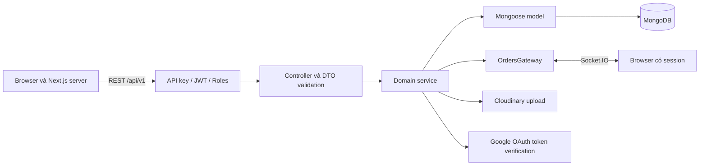

# Smart Order — Server

Backend của ứng dụng gọi món tại bàn và quản lý nhà hàng, xây dựng bằng **NestJS trên Express**, cung cấp REST API có version, Socket.IO và tích hợp MongoDB/Cloudinary. [Client](../client/README.md) là ứng dụng Next.js riêng, gọi REST từ cả browser và Next.js server.

Tài liệu dựa trên source code, scripts, lockfile và cấu hình repository; chưa có `.env.example`. Mọi secret bên dưới đều là placeholder, không lấy từ `.env` hay file khóa.

## Mục lục

- [Phạm vi chức năng và công nghệ](#phạm-vi-chức-năng-và-công-nghệ)
- [Kiến trúc và tổ chức code](#kiến-trúc-và-tổ-chức-code)
- [API, xác thực và xử lý lỗi](#api-xác-thực-và-xử-lý-lỗi)
- [Cài đặt và cấu hình](#cài-đặt-và-cấu-hình)
- [Chạy local và dữ liệu ban đầu](#chạy-local-và-dữ-liệu-ban-đầu)
- [Các lệnh có sẵn](#các-lệnh-có-sẵn)
- [Lỗi thiết lập và giới hạn](#lỗi-thiết-lập-và-giới-hạn)
- [Kiểm chứng và đề xuất bổ sung](#kiểm-chứng-và-đề-xuất-bổ-sung)

## Phạm vi chức năng và công nghệ

| Module | Trách nhiệm |
| --- | --- |
| `auth`, `accounts` | Tài khoản nhân viên, đăng nhập mật khẩu/OAuth, access/refresh token, hồ sơ và mật khẩu |
| `customers` | Phiên khách theo bàn, đăng nhập bằng token bàn, đặt/xem đơn của khách |
| `tables` | Bàn, trạng thái, token và liên kết `/reservation?token=...` cho QR |
| `categories`, `dishes` | Danh mục và món: giá, thời gian chế biến, ảnh, trạng thái |
| `orders` | Tạo/xem/sửa/xóa đơn, thống kê theo bàn, chuyển trạng thái, checkout và phát sự kiện realtime |
| `bills`, `dashboard` | Hóa đơn và thống kê kinh doanh |
| `media`, `cloudinary` | Nhận ảnh multipart và upload Cloudinary |

Checkout ở đây cập nhật đơn, tạo hóa đơn, giải phóng bàn và phát sự kiện đăng xuất khách; chưa thấy tích hợp cổng thanh toán. `chat` có source và test riêng nhưng `ChatModule` không được import vào `AppModule`, nên chưa phải chức năng đang được bật.

| Công nghệ | Phiên bản / ghi chú |
| --- | --- |
| Node.js | **24.x**, khai báo trong `package.json.engines` |
| npm | Có lockfile phiên bản 3, không pin package manager; devDependency `npm: ^11.2.0` |
| NestJS | Khai báo major 10, lockfile `@nestjs/core: 10.4.22`; Express adapter |
| Express | Dependency khai báo `^5.2.1` |
| TypeScript | Khai báo `^5.1.3`, lockfile `5.9.3` |
| MongoDB / Mongoose | Mongoose `^8.23.0`, `@nestjs/mongoose ^10.1.0`; chưa pin phiên bản MongoDB server |
| Xác thực / validation | Passport Local/JWT, bcrypt, Joi, class-validator, class-transformer |
| Realtime / tài liệu API | Socket.IO `^4.8.1`, NestJS Swagger `^7.0.0` |
| Media / kiểm thử | Cloudinary SDK, Multer interceptors; Jest 29, ts-jest, Supertest |

Có CASL, XState và Throttler trong dependencies. Quyền thực tế hiện dùng guards/role; CASL chưa được áp dụng toàn cục, Throttler registration/guard đang bị comment, state machine đơn là bảng chuyển trạng thái tự khai báo. Không suy ra tính năng chỉ từ dependency.

## Kiến trúc và tổ chức code



- `AppModule` ghép các domain. Mỗi domain thường có controller tiếp nhận HTTP, DTO khai báo dữ liệu, service xử lý nghiệp vụ và schema Mongoose. Các module liên kết qua dependency injection; orders/customers/bills có phụ thuộc vòng dùng `forwardRef`.
- `CoreModule` nạp `.env`, kiểm tra Joi, kết nối database và đăng ký guards, pipe, interceptor, exception filter toàn cục.
- `nest-cli.json` chọn **`main-v2`** làm entry: chạy HTTP server bằng `app.listen(port)`, Helmet, CORS `origin: '*'`, cookie parser, URI versioning và Swagger.
- `src/main.ts` là entry handler cho serverless: chỉ `app.init()`, không `listen()`. `api/index.ts` import `dist/main`, `vercel.json` chuyển mọi route vào handler. Cấu hình này có trong repo nhưng chưa xác minh deployment hoặc Socket.IO trên hosting đó.

```text
src/
  main-v2.ts            Entry HTTP local theo nest-cli.json
  main.ts               Handler Express/NestJS cho serverless
  app.module.ts         Ghép các domain đang hoạt động
  app.controller.ts     Endpoint chào đơn giản
  config/               Ánh xạ environment, port, database, token, URL, upload
  core/
    core.module.ts      Cấu hình dùng chung và providers toàn cục
    guards/             API key, JWT, role; guards bổ trợ
    decorators/         Public, Roles, CustomerRoute, Account, Customer...
    casl/               Ability factory; chưa áp dụng toàn cục
    pipes/              Validate ObjectId và khoảng ngày
    exceptions/         Lỗi nghiệp vụ và exception filters
    interceptors/       Chuẩn hóa response thành công
    query-string-dtos/  Phân trang và khoảng ngày
  domains/
    <domain>/           Module, controller, service, dto(s), schema(s)
    orders/             Có OrdersGateway và bảng chuyển trạng thái đơn
    chat/               Source thử nghiệm, chưa ghép vào AppModule
api/index.ts            Entry serverless import dist/main
vercel.json             Cấu hình build/routing Vercel
```

Database có các collection `Accounts`, `Customers`, `Tables`, `Categories`, `Dishes`, `Orders`, `Bills`. Món tham chiếu danh mục; đơn tham chiếu khách/món; bàn có khách hiện tại; hóa đơn có người lập và danh sách món. Schema nằm cạnh domain. Không tìm thấy migration, seed, Docker Compose hoặc script tự tạo tài khoản quản lý; chưa có quy trình quản lý thay đổi schema được ghi nhận.

## API, xác thực và xử lý lỗi

Với cấu hình local bên dưới:

- REST base URL: `http://localhost:8000/api/v1`.
- Swagger UI: `http://localhost:8000/docs`; OpenAPI JSON của entry local: `http://localhost:8000/docs/json`.
- Socket.IO: `http://localhost:8000`, dùng chung HTTP server, không thêm `/api/v1`.
- Static assets: `/public/` ánh xạ thư mục `upload` ở project root khi chạy output trong `dist`; luồng upload hiện tại dùng Cloudinary, phần lưu file local đang comment.

Các nhóm endpoint chính; đường dẫn bảng này nối sau `/api/v1`:

| Endpoint | Hành vi / quyền nổi bật |
| --- | --- |
| `GET /` | Trả dữ liệu `Hello world`, dùng kiểm tra HTTP/API key, không phải health check đầy đủ |
| `POST /auth/login`, `/auth/login/oauth`, `/auth/register`, `/auth/refresh-token` | Đăng nhập, đăng ký nhân viên mặc định `Waiter`, refresh token; không yêu cầu JWT nhân viên |
| `PATCH /auth/forgot-password` | Có endpoint cập nhật mật khẩu theo email; chưa thấy bước xác minh email/OTP |
| `PATCH /auth/change-password`, `/auth/profile`; `POST /auth/logout` | Mật khẩu, hồ sơ và đăng xuất nhân viên |
| `/accounts`, `/accounts/:id` | CRUD tài khoản, `Manager` |
| `/categories`, `/categories/:id` | CRUD danh mục; `GET /categories` public |
| `/dishes`, `/dishes/:id` | CRUD món; GET public, ghi dữ liệu dành cho `Manager`/`Chef` |
| `/tables`, `/tables/:id` | CRUD bàn; GET danh sách public, thao tác còn lại `Manager`/`Waiter` |
| `POST /customers/auth/login`, `/customers/auth/refresh-token`, `/customers/auth/logout` | Phiên khách; login nhận `tableToken` |
| `GET /customers`, `GET /customers/me`, `GET/POST /customers/orders` | Danh sách cho nhân viên; `/me` và `/orders` dùng JWT khách |
| `/orders`, `/orders/:id`, `DELETE /orders/bulk-delete` | Đơn và trạng thái; các endpoint yêu cầu JWT nhân viên, role cụ thể tùy handler |
| `GET /orders/statistics-by-tables` | Thống kê đơn theo bàn |
| `GET /orders/checkout/:customerId` | Thao tác thay đổi dữ liệu: checkout, tạo bill, giải phóng bàn; `Manager`/`Waiter` |
| `GET/POST /bills`, `GET /dashboard` | Hóa đơn cho `Manager`/`Waiter`; dashboard cho `Manager` |
| `POST /media/upload/single`, `/media/upload/multiple` | Multipart trường `file`/`files`, tùy chọn header `folder-name` |

Xem controller và DTO để biết body/query bắt buộc; Swagger được tạo từ source nhưng không nên giả định mọi schema hoặc nút Authorize đã đầy đủ. Swagger builder chưa khai báo security scheme cho API key/Bearer; có thể dùng HTTP client có header tường minh.

**Xác thực và phân quyền thực tế:**

- `ApiKeyGuard` áp dụng toàn cục, yêu cầu `x-api-key` bằng `API_KEY` **kể cả route `@Public()`**. `Public` chỉ bỏ qua JWT/role tương ứng. Client gửi cùng giá trị qua `NEXT_PUBLIC_API_KEY`, vì vậy đây là giá trị được browser nhìn thấy.
- `JwtEmployeeAuthGuard` và `RolesGuard` áp dụng toàn cục. Vai trò là `Manager`, `Waiter`, `Chef`; endpoint không có `@Roles` vẫn có thể yêu cầu JWT nhân viên. Customer routes đặt metadata riêng và gắn `JwtCustomerAuthGuard` nơi cần, không dùng JWT nhân viên thay JWT khách.
- Nhân viên đăng nhập bằng email và mật khẩu đã mã hóa **RSA-OAEP/SHA-1**, base64 từ client. Backend đọc `src/config/private-key.pem` theo `process.cwd()`, giải mã rồi so sánh bcrypt; public key tương ứng nằm ở `LOGIN_PUBLIC_KEY` của client. Không có biến `LOGIN_PRIVATE_KEY` trong code.
- Access/refresh token có secret và thời hạn riêng cho nhân viên/khách; refresh token được lưu theo tài khoản/khách. Token bàn ký bằng `TABLE_TOKEN_SECRET`, dùng tạo liên kết reservation.
- OAuth yêu cầu tài khoản đã tồn tại theo email. Client bật Google và GitHub provider; backend xác minh Google và có nhánh Facebook, nhưng enum nghiệp vụ chỉ có Google, chưa có luồng GitHub đồng bộ.
- Media handler hiện chỉ có metadata `@AuthenticatedUserAccess()`, làm global JWT/role guard bỏ qua; chưa thấy gắn `JwtAuthenticatedAuthGuard` trên handler. Vì thế không mô tả upload là đã xác thực JWT đầy đủ; API key vẫn được kiểm tra.

`OrdersGateway` kiểm tra JWT từ `handshake.auth.authorization` theo `auth.role`. Nhân viên vào `employeeRoom`; gateway phát `newOrders`, `updatedOrder`, `logout`, và `unauthorized_error` khi kết nối không hợp lệ. `order.machine.ts` cho phép luồng `Pending → Confirmed → Cooked → Served → Paid`, kèm các nhánh hủy/từ chối được khai báo rõ trong bảng FSM.

**Validation và response:** global `ValidationPipe` bật `whitelist`, `transform`, chuyển kiểu ngầm và dừng tại lỗi đầu; lỗi DTO trả 422 với thông tin field. ObjectId/khoảng ngày có pipe riêng. Response thành công qua interceptor thành `{ statusCode, message, data }`, thêm `meta` khi phân trang. `AnyExceptionFilter` giữ response của HTTP exception và định dạng lỗi ngoài dự kiến thành 500; không phải mọi lỗi đều có cùng cấu trúc thành công.

## Cài đặt và cấu hình

Cần Git, Node.js 24.x/npm, một MongoDB truy cập được và cấu hình Cloudinary. Joi bắt buộc có các biến Cloudinary ngay lúc khởi động; upload thực tế cần credentials hợp lệ. Chưa xác định phiên bản MongoDB tối thiểu từ repo.

Nếu chưa có workspace, clone backend vào đúng tên thư mục để các liên kết README hai phần hoạt động:

```bash
mkdir smart-order
cd smart-order
git clone git@github.com:locphudev54/smart-order-be.git server
cd server
npm ci
```

Remote SSH lấy từ `origin`, cần quyền truy cập GitHub. Clone frontend cạnh `server` theo [README client](../client/README.md#cài-đặt-và-cấu-hình). Nếu workspace đã có sẵn, chỉ vào `server` và cài dependencies. PowerShell bị chặn `npm.ps1` có thể dùng `npm.cmd` thay `npm`.

Tạo `server/.env` thủ công, chạy lệnh từ thư mục `server`. `ConfigModule.forRoot` nạp file môi trường mặc định; source không cấu hình lựa chọn `.env.production` tự động. Các biến sau được kiểm tra trong `core/core.module.ts`, ánh xạ ở `src/config` hoặc đọc bởi Cloudinary/API key provider:

| Biến | Yêu cầu / mục đích | Ví dụ an toàn |
| --- | --- | --- |
| `NODE_ENV` | Bắt buộc; `development`, `production`, `test`, `provision` | `development` |
| `PORT` | Bắt buộc theo Joi, dù config có fallback 8000 | `8000` |
| `DEVELOPMENT_DATABASE_URI` | Bắt buộc theo Joi; dùng khi khác `production` | `mongodb://127.0.0.1:27017/smartorder` |
| `PRODUCTION_DATABASE_URI` | Cần khi `NODE_ENV=production`; chưa được Joi kiểm tra | `mongodb://<host>:27017/<database>` |
| `CLIENT_BASE_URL` | Bắt buộc; tạo liên kết reservation của bàn | `http://localhost:3000` |
| `SERVER_BASE_URL` | Bắt buộc; URL backend, có chỗ dùng trong luồng upload local đang comment | `http://localhost:8000` |
| `MULTER_DEFAULT_DEST` | Bắt buộc; cấu hình đích upload local, hiện storage local đang comment | `upload` |
| `API_KEY` | Bắt buộc; so sánh header `x-api-key`, khớp client | `replace-with-shared-local-api-key` |
| `EMPLOYEE_ACCESS_TOKEN_SECRET` | Bắt buộc; ký JWT nhân viên | `replace-with-random-employee-access-secret` |
| `EMPLOYEE_ACCESS_TOKEN_EXPIRATION_TIME` | Bắt buộc; chuỗi thời gian đọc qua `ms` | `30m` |
| `EMPLOYEE_REFRESH_TOKEN_SECRET` | Bắt buộc; ký refresh token nhân viên | `replace-with-random-employee-refresh-secret` |
| `EMPLOYEE_REFRESH_TOKEN_EXPIRATION_TIME` | Bắt buộc; thời hạn refresh token | `7d` |
| `CUSTOMER_ACCESS_TOKEN_SECRET` | Bắt buộc; ký JWT khách | `replace-with-random-customer-access-secret` |
| `CUSTOMER_ACCESS_TOKEN_EXPIRATION_TIME` | Bắt buộc; thời hạn access token khách | `30m` |
| `CUSTOMER_REFRESH_TOKEN_SECRET` | Bắt buộc; ký refresh token khách | `replace-with-random-customer-refresh-secret` |
| `CUSTOMER_REFRESH_TOKEN_EXPIRATION_TIME` | Bắt buộc; thời hạn refresh token khách | `7d` |
| `TABLE_TOKEN_SECRET` | Bắt buộc; ký token bàn | `replace-with-random-table-secret` |
| `CLOUDINARY_CLOUD_NAME` | Bắt buộc; tài khoản lưu ảnh | `replace-with-cloud-name` |
| `CLOUDINARY_API_KEY` | Bắt buộc; Cloudinary credentials | `replace-with-cloudinary-api-key` |
| `CLOUDINARY_API_SECRET` | Bắt buộc; Cloudinary credentials | `replace-with-cloudinary-api-secret` |

Khung local, thay placeholder bằng giá trị riêng cho môi trường của bạn:

```dotenv
NODE_ENV=development
PORT=8000
DEVELOPMENT_DATABASE_URI=mongodb://127.0.0.1:27017/smartorder
CLIENT_BASE_URL=http://localhost:3000
SERVER_BASE_URL=http://localhost:8000
MULTER_DEFAULT_DEST=upload
API_KEY=replace-with-shared-local-api-key
EMPLOYEE_ACCESS_TOKEN_SECRET=replace-with-random-employee-access-secret
EMPLOYEE_ACCESS_TOKEN_EXPIRATION_TIME=30m
EMPLOYEE_REFRESH_TOKEN_SECRET=replace-with-random-employee-refresh-secret
EMPLOYEE_REFRESH_TOKEN_EXPIRATION_TIME=7d
CUSTOMER_ACCESS_TOKEN_SECRET=replace-with-random-customer-access-secret
CUSTOMER_ACCESS_TOKEN_EXPIRATION_TIME=30m
CUSTOMER_REFRESH_TOKEN_SECRET=replace-with-random-customer-refresh-secret
CUSTOMER_REFRESH_TOKEN_EXPIRATION_TIME=7d
TABLE_TOKEN_SECRET=replace-with-random-table-secret
CLOUDINARY_CLOUD_NAME=replace-with-cloud-name
CLOUDINARY_API_KEY=replace-with-cloudinary-api-key
CLOUDINARY_API_SECRET=replace-with-cloudinary-api-secret
```

Khi production, thêm `PRODUCTION_DATABASE_URI`; Joi hiện vẫn yêu cầu `DEVELOPMENT_DATABASE_URI` dù không dùng kết nối development. Không dùng các placeholder làm secret thật. Không đưa URI có mật khẩu, credentials, token hoặc nội dung PEM vào tài liệu.

**Khóa RSA:** chuẩn bị cặp khóa riêng cho local theo quy trình maintainer, đặt private key ở `server/src/config/private-key.pem` và public key tương ứng trong `client/.env` qua `LOGIN_PUBLIC_KEY`. Không copy giá trị khóa từ README. Source hiện cố định đường dẫn file, nên chạy từ đúng thư mục `server`; khởi động server thành công chưa chứng minh đăng nhập giải mã được. Chưa có script quản lý/cấp mới khóa trong repo.

## Chạy local và dữ liệu ban đầu

1. Khởi động MongoDB bằng cách cài đặt phù hợp với máy hoặc chuẩn bị database remote riêng cho phát triển. URI phải trỏ tới database có quyền đọc/ghi; repo chưa cung cấp Docker Compose hay lệnh khởi tạo database.
2. Cài dependencies và tạo `.env` theo trên. Chuẩn bị Cloudinary và cặp khóa RSA nếu kiểm tra đầy đủ upload/đăng nhập.
3. Từ `server`, chạy:

   ```bash
   npm run dev
   ```

   Nest CLI dùng `main-v2.ts`, lắng nghe `PORT=8000`. Mongoose kết nối database; không có bước migration/seed tự động được tìm thấy. MongoDB tạo dữ liệu/collection khi ứng dụng ghi theo schema, nhưng không tự có dữ liệu demo.

4. Kiểm tra Swagger và HTTP. Ví dụ dưới đây dùng đúng placeholder trong khung local; thay bằng API key local đã cấu hình, không commit lệnh chứa giá trị thật:

   ```bash
   curl -i -H "x-api-key: replace-with-shared-local-api-key" http://localhost:8000/api/v1
   curl -i -H "x-api-key: replace-with-shared-local-api-key" http://localhost:8000/api/v1/categories
   ```

   Trên Windows PowerShell dùng `curl.exe` để tránh alias `Invoke-WebRequest`. Kỳ vọng endpoint đầu trả HTTP 200, JSON có `statusCode`, `message`, `data: "Hello world"`; endpoint thứ hai trả danh sách (có thể rỗng). Đây không phải kiểm tra toàn bộ DB/upload/OAuth.

5. **Dữ liệu và tài khoản:** chưa có seed hoặc tài khoản demo được xác nhận. `POST /api/v1/auth/register` nhận `fullName`, `email`, `password` và mặc định tạo `Waiter`; DTO yêu cầu tên 8–40 ký tự, mật khẩu 8–40 ký tự. Đây là đăng ký tài khoản, không phải quy trình bootstrap `Manager`. Nhờ maintainer cung cấp tài khoản quản lý local hoặc quy trình tạo quản lý có kiểm soát; không suy đoán mật khẩu mặc định.
6. Khi đã có tài khoản phù hợp, tạo danh mục trước, tạo món gắn ObjectId danh mục, rồi tạo bàn theo API/DTO. Tạo bàn sinh `token` và `reservationLink` từ `CLIENT_BASE_URL`; client dùng liên kết này để vào bàn. Chưa có màn hình CRUD danh mục riêng trên client, có thể cần gọi API bằng tài khoản nhân viên.
7. Khởi động client theo README tương ứng. Kiểm tra luồng khách vào bàn → tạo đơn → nhân viên cập nhật trạng thái → checkout → hóa đơn/bàn trống và sự kiện logout. Các thao tác này ghi dữ liệu, chỉ kiểm tra trên database phát triển riêng.

## Các lệnh có sẵn

| Lệnh trong `package.json` | Mục đích / lưu ý |
| --- | --- |
| `npm run dev` | `nest start --watch`, entry local `main-v2` |
| `npm run start` | `nest start`, không watch |
| `npm run start:debug` | Nest debug và watch |
| `npm run build` | `nest build`, xuất vào `dist`; cấu hình có `deleteOutDir` |
| `npm run start:prod` | `node dist/main`; hiện trỏ handler serverless, không mở HTTP listener local |
| `npm run lint` | ESLint kèm `--fix`, có thể sửa source |
| `npm run format` | Prettier ghi lại `src/**/*.ts`, `test/**/*.ts`; chưa có thư mục `test` |
| `npm test`, `npm run test:watch` | Jest và chế độ watch |
| `npm run test:cov`, `npm run test:debug` | Coverage và debug Jest |
| `npm run test:e2e` | Trỏ `./test/jest-e2e.json`, file này chưa có |

Entry HTTP đã build là `dist/main-v2.js`; nếu thử chạy HTTP từ output build, dùng `npm run build` rồi `node dist/main-v2.js` từ thư mục server. Chưa kiểm chứng đường chạy này trong đợt tài liệu; `start:prod` hiện không tương đương đường chạy HTTP đó. Cần maintainer thống nhất entry local/production/serverless trước khi dùng làm quy trình deployment.

Lệnh bổ trợ kiểm tra không tạo output, không sửa source (không phải npm script có sẵn):

```bash
node node_modules/typescript/bin/tsc --project tsconfig.build.json --noEmit --incremental false --pretty false
node node_modules/jest/bin/jest.js --listTests --runInBand
```

## Lỗi thiết lập và giới hạn

| Hiện tượng | Căn cứ và cách xử lý |
| --- | --- |
| `Config validation error` | Kiểm tra đủ biến theo Joi, kể cả Cloudinary, `PORT`, `DEVELOPMENT_DATABASE_URI`; chạy từ thư mục `server` |
| Không kết nối MongoDB / server chưa sẵn sàng | Kiểm tra dịch vụ database, URI theo `NODE_ENV`, quyền truy cập và network; production phải có `PRODUCTION_DATABASE_URI` |
| HTTP 400 thiếu API key hoặc 401 `INVALID_API_KEY` | Gửi `x-api-key` đúng giá trị cho mọi controller API, kể cả login/GET public |
| 401 `ACCESS_TOKEN_REQUIRED`, `INVALID_ACCESS_TOKEN`, `ACCESS_TOKEN_EXPIRED` | Kiểm tra `Authorization: Bearer ...`, loại token khách/nhân viên và thời hạn; dùng refresh token đúng loại |
| HTTP 403 | Đối chiếu `@Roles` của handler và role tài khoản; tài khoản đăng ký mới mặc định `Waiter` |
| Lỗi đọc PEM/giải mã mật khẩu | Kiểm tra file `src/config/private-key.pem`, thư mục chạy và cặp khóa khớp `LOGIN_PUBLIC_KEY`; code dùng OAEP/SHA-1 |
| `start:prod` không nhận kết nối HTTP | Script chạy `dist/main` chỉ có handler và `app.init()`; xem sự khác biệt entry ở trên |
| Cloudinary upload lỗi | Cần credentials hợp lệ; multipart đúng tên `file`/`files`, MIME JPEG/PNG/GIF/WebP. Single giới hạn 4 MiB; multiple tối đa 10 file với `fileSize` hiện là 40 MiB mỗi file trong cấu hình Multer |
| Liên kết QR sai host hoặc table token không hợp lệ | Kiểm tra `CLIENT_BASE_URL`, token được server tạo và `TABLE_TOKEN_SECRET`; đổi secret làm token cũ không còn hợp lệ |
| Test chat timeout / kết nối sai | Test tạo app ở 3000 nhưng client trỏ 8000, chưa dùng namespace `/chat`; không xem đây là integration test đã hoạt động |
| `test:e2e` thiếu config | Chưa có `test/jest-e2e.json`; cần bổ sung test/config trước khi dùng lệnh |
| PowerShell chặn `npm.ps1` | Dùng `npm.cmd` |

Các giới hạn đã thấy trong code: CORS REST/Socket.IO đang cho phép `*`, rate limiting chưa bật; checkout là GET có thay đổi dữ liệu và nhiều bước ghi chưa thấy transaction. Endpoint forgot-password chưa có bước xác minh email; upload chưa gắn JWT guard như mô tả ở trên. Đây là các điểm maintainer cần rà soát trước khi khẳng định mức sẵn sàng production.

## Kiểm chứng và đề xuất bổ sung

Đã đối chiếu scripts, entry files, route decorators, DTO, schemas, biến môi trường và luồng client–server. Trên dependencies hiện có với Node.js `24.12.0`, npm `11.6.2`:

- TypeScript với `tsconfig.build.json`, `--noEmit --incremental false`: **thành công**.
- Jest `--listTests --runInBand`: **thành công**, tìm thấy một file `src/domains/chat/chat.gateway.spec.ts`; không phải đã chạy test assertions.
- Chưa chạy Jest thực tế vì test socket có cổng/namespace không đồng bộ, có thể chờ timeout. Chưa chạy E2E vì thiếu config.
- Chưa cài lại dependencies, build/start hoặc gọi API với dịch vụ thật. Đợt tài liệu không nạp `.env`, không đọc PEM/credentials và chỉ thay README; lint/format có chế độ ghi nên không chạy. Kiểm tra tĩnh không xác nhận database/OAuth/Cloudinary hoặc deployment hoạt động.

**Đề xuất, cần maintainer cung cấp hoặc quyết định:**

- `.env.example` an toàn, quy trình cấp/luân chuyển RSA và secrets, bootstrap Manager, seed demo và phiên bản MongoDB được hỗ trợ.
- Ma trận quyền theo endpoint, hợp đồng API/error và sự kiện Socket.IO; xác nhận phạm vi OAuth, reset password, upload và thanh toán.
- Coding conventions, quy trình đóng góp/review, chiến lược test và CI kiểm tra lint/type/build/test. Chưa thấy workflow CI được version-control.
- Quy trình deployment, entry production thống nhất, hosting hỗ trợ WebSocket, cấu hình CORS/rate limit, backup/restore, log/monitoring và xử lý nhất quán các bước checkout. `vercel.json` hiện chỉ chứng minh có cấu hình Vercel, chưa chứng minh deploy thành công.

Tham khảo: [README client](../client/README.md), [repository frontend](https://github.com/locphudev54/smart-order-fe), [scripts](package.json), [Nest CLI config](nest-cli.json), [CoreModule](src/core/core.module.ts), [entry local](src/main-v2.ts), [entry serverless](src/main.ts), [AppModule](src/app.module.ts), [OrdersGateway](src/domains/orders/orders.gateway.ts), [Vercel config](vercel.json). Chi tiết body/query nằm trong controller và thư mục DTO của từng domain; Swagger local là tài liệu API sinh từ code.
